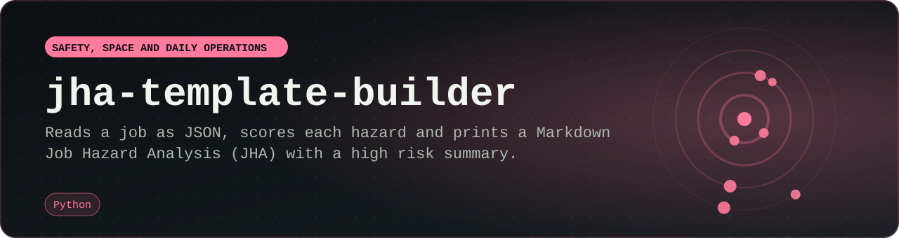
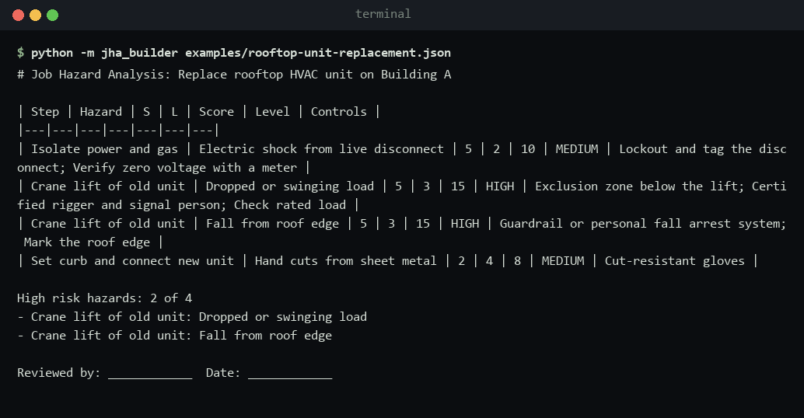

<p align="center"></p>

# jha-template-builder

Reads a job as JSON, scores each hazard and prints a Markdown Job Hazard Analysis (JHA) with a high risk summary.



## What it is for

A Job Hazard Analysis lists the steps of a task, the hazards in each step and the controls that reduce them. Before work such as a rooftop unit swap, crews need one on paper. A safety officer, project engineer or maintenance planner describes the job in a JSON file. The tool checks that it is complete and produces a consistent sheet, with the high risk hazards listed at the bottom for the pre-task briefing.

## Install

```
git clone <repo-url> jha-template-builder
cd jha-template-builder
pip install -e .
```

## How to use

| I want to | Command |
|---|---|
| Build a JHA from a job file | `python -m jha_builder examples/rooftop-unit-replacement.json` |
| Save the JHA to a Markdown file | `python -m jha_builder examples/rooftop-unit-replacement.json > jha.md` |
| See the built-in help | `python -m jha_builder --help` |
| Run the tests | `python -m pytest -q` |

The tool takes one job file and has no other options.

Worked example:

```
python -m jha_builder examples/rooftop-unit-replacement.json
```

```
# Job Hazard Analysis: Replace rooftop HVAC unit on Building A

| Step | Hazard | S | L | Score | Level | Controls |
|---|---|---|---|---|---|---|
| Isolate power and gas | Electric shock from live disconnect | 5 | 2 | 10 | MEDIUM | Lockout and tag the disconnect; Verify zero voltage with a meter |
| Crane lift of old unit | Dropped or swinging load | 5 | 3 | 15 | HIGH | Exclusion zone below the lift; Certified rigger and signal person; Check rated load |
| Crane lift of old unit | Fall from roof edge | 5 | 3 | 15 | HIGH | Guardrail or personal fall arrest system; Mark the roof edge |
| Set curb and connect new unit | Hand cuts from sheet metal | 2 | 4 | 8 | MEDIUM | Cut-resistant gloves |

High risk hazards: 2 of 4
- Crane lift of old unit: Dropped or swinging load
- Crane lift of old unit: Fall from roof edge

Reviewed by: ____________  Date: ____________
```

## How it works

- Each hazard has severity and likelihood as whole numbers from 1 to 5.
- Score is severity times likelihood. 15 and above is HIGH, 8 to 14 is MEDIUM, below 8 is LOW.
- The job is rejected if the title is missing, no hazards exist, a rating is outside 1 to 5, or a hazard has no controls.
- The output keeps step order and ends with a count of high risk hazards and a review line.

## Limits

Scores show the risk before controls are applied, and there is no residual risk column. The thresholds are a simple convention, not a standard. A competent person must review every JHA. Run the tests with `pip install pytest` first.

## License

MIT. Copyright 2026 Yassine Emhamed.
